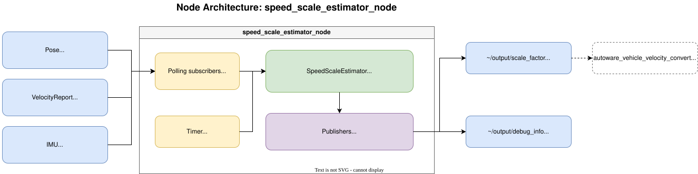
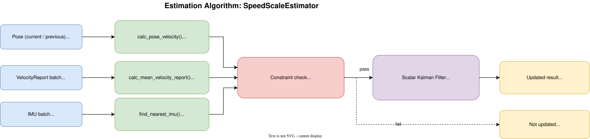

# autoware_speed_scale_estimator

## Overview

This package estimates the vehicle speed scale factor by comparing pose-derived velocity from consecutive localization poses with wheel velocity reported by the vehicle. The reference velocity is computed from pose position differences (e.g. NDT scan matcher output), so the estimate reflects consistency between localization motion and wheel speed.

The estimated scale factor can be used to monitor and tune the speed scale in `autoware_vehicle_velocity_converter`. The node runs periodically at `update_interval` and updates the estimate only when all operational constraints are satisfied.

## Package Architecture

The package is split into a core library and a ROS adapter layer. The core implements estimation without ROS topic subscription or publication; it uses `rclcpp::Time` only for timestamp handling. Core logic can be unit-tested without spinning up a ROS graph.

| Layer | Library                              | Responsibility                                                                                           |
| ----- | ------------------------------------ | -------------------------------------------------------------------------------------------------------- |
| Core  | `autoware_speed_scale_estimator`     | Utils, Kalman filter estimation (`SpeedScaleEstimator`); no ROS graph I/O                                |
| ROS   | `autoware_speed_scale_estimator_ros` | Message handling, debug formatting, node I/O (`SpeedScaleEstimatorProcessor`, `SpeedScaleEstimatorNode`) |

## Block Diagram

### Node architecture

ROS node interfaces and publish timing.

### Estimation algorithm

Internal processing flow inside `SpeedScaleEstimator`.

## Algorithm

The speed scale estimation follows these steps:

### 1. Data Collection

- Collects pose (`PoseStamped`), IMU, and vehicle velocity reports (`VelocityReport`) received since the previous timer callback
- Optionally collects the NDT initial-to-result relative pose (`PoseStamped`) and the environment id (`Int32Stamped`) used by the localization quality constraints, when the corresponding constraint is enabled
- Keeps IMU, velocity report, and the optional localization quality messages in rolling buffers of length `sensor_buffer_duration` for timestamp synchronization
- Keeps the previous pose internally to compute pose velocity between consecutive updates

### 2. Pose Velocity Calculation

Computes pose velocity from the previous and current poses:

$$
v_{pose} = \frac{\| \Delta \mathbf{p} \|}{\Delta t}
$$

If the time difference between the two poses exceeds `max_pose_lag`, the previous pose is reset and estimation is skipped.

### 3. Timestamp Synchronization

For the current pose timestamp, the estimator selects from the rolling buffers:

- the nearest IMU sample for angular velocity constraint checking
- the nearest velocity report for Kalman filter observation
- the nearest environment id, when the degenerate environment constraint is enabled

Estimation is skipped when any of these timestamp differences exceeds `max_stamp_lag`.

The NDT correction constraint is not a single-sample lookup: because $v_{pose}$ is derived from both ends of the pose interval, the estimator takes the worst correction over $[t_{prev}, t_{curr}]$ and additionally requires a sample within `max_stamp_lag` of each end, so that the interval is actually covered by the buffer.

### 4. Constraint Validation

Estimation is performed only when all of the following constraints are satisfied:

- **Angular velocity constraint (IMU)** — $|\omega_{imu}| \leq \omega_{max}$

  Default $\omega_{max} \approx 0.6\ \mathrm{deg/s}$ ($0.0105\ \mathrm{rad/s}$) rejects obvious curves and turns. This threshold is set near the practical IMU bias/noise floor rather than fine straight-line discrimination.

- **Speed constraints (pose velocity)** — $v_{min} \leq v_{pose} \leq v_{max}$

  Default $v_{min} = 6.0\ \mathrm{m/s}$ rejects low-speed samples where pose-differentiation SNR is poor: at short $\Delta t$, displacement $\|\Delta \mathbf{p}\|$ becomes comparable to localization pose noise (e.g. NDT jitter), so relative error in $v_{pose} = \|\Delta \mathbf{p}\| / \Delta t$ grows and corrupts the scale-factor observation $z = v_{pose}$. Wheel speed reports also tend to have larger relative uncertainty near standstill or creep. In practice, sub-6 m/s segments are often urban and involve frequent acceleration/deceleration, which further degrades consistency between pose-derived and wheel-reported velocity. Default $v_{max} = 17.0\ \mathrm{m/s}$ filters out extreme speeds. Together with $\omega_{max}$, estimation runs mainly on moderate-speed, near-straight segments (~22 km/h and above).

  Estimation is intentionally skipped in urban/low-speed segments. Lower `min_speed` if broader coverage is needed, accepting higher estimate variance.

- **Wheel velocity validity** — $|v_{wheel}| > 10^{-6}$

- **NDT scan matching stability** (`enable_ndt_stability_check`, enabled by default)

  `ndt_scan_matcher` publishes `initial_to_result_relative_pose`, which is its converged pose expressed in the frame of the initial guess it started from. Its `position.x` is therefore the correction NDT applied _along_ the predicted heading and `position.y` the correction _across_ it. Estimation requires $|x| \leq$ `max_ndt_longitudinal_correction` and $|y| \leq$ `max_ndt_lateral_correction` over the whole pose interval.

  The longitudinal axis is the one that degrades in degenerate environments, and it is also the axis that directly corrupts $v_{pose} = \|\Delta \mathbf{p}\| / \Delta t$, so a large correction there is exactly the condition to reject. Defaults of 0.15 m match the order of the empirical NDT position standard deviation configured in `ndt_scan_matcher` (`output_pose_covariance[0]` = 0.0225, i.e. $\sigma = 0.15\ \mathrm{m}$). The `initial_to_result_distance_tolerance_m` diagnostic threshold (3.0 m by default) is deliberately not reused: it is sized to detect NDT breakdown, not the sub-decimeter jitter that matters here.

  This constraint is used instead of the `pose_instability_detector` diagnostic. That detector compares the EKF pose against gyro-plus-wheel dead reckoning rather than looking at NDT directly, and its thresholds include `heading_velocity_scale_factor_tolerance` (3 % by default) — so a wheel speed scale error above 3 % would itself trip the detector and gate out precisely the samples needed to estimate that error. `initial_to_result_relative_pose` shares the same initial-pose dependency in principle, but it only accumulates one scan (~0.1 s) of prediction error, roughly 0.05 m at 16 m/s with a 3 % scale error, which stays well inside the 0.15 m threshold.

- **Degenerate environment** (`enable_degenerate_environment_check`, disabled by default)

  `environment_adaptor` publishes `~/debug/environment_id`, and estimation is allowed only when it is contained in `allowed_environment_ids`. With the default `environment_adaptor` configuration, 0 is a normal environment, 1 a uniform road, and 2 a feature-poor road. In a degenerate area NDT slips longitudinally, so $\|\Delta \mathbf{p}\|$ no longer tracks the true traveled distance.

  Two caveats explain the default:

  - The judgement is purely a 2D point-in-polygon test against `degenerate_area` polygons annotated in the lanelet2 map — there is no online degeneracy detection — so the constraint is only as good as the map annotation.
  - `environment_adaptor` is not launched by default (`use_autoware_environment_adaptor` is false), so the topic is normally absent.

  When the constraint is enabled and no sufficiently recent environment id is available, estimation is skipped rather than assumed safe. The subscription is only created when the constraint is enabled, so the default configuration adds no topic dependency.

  This also matches how `environment_adaptor` is meant to be used: it applies a per-area `longitudinal_scale_factor` from the map inside degenerate areas, so the global scale factor is best estimated outside them.

### 5. Scale Factor Estimation (Kalman Filter)

The scale factor is modeled as a scalar state $x$ with the observation:

$$
z = v_{pose} = x \cdot v_{wheel}
$$

Kalman filter update:

**Prediction:**

$$
x_{pred} = x,\quad P_{pred} = P + Q
$$

**Update:**

$$
H = v_{wheel},\quad y = z - H x_{pred}
$$

$$
S = H^2 P_{pred} + R,\quad K = \frac{P_{pred} H}{S}
$$

$$
x = x_{pred} + K y,\quad P = (1 - K H) P_{pred}
$$

## Inputs / Outputs

### Input Topics

| Name                                          | Type                                              | Description                                                                                                                                       |
| --------------------------------------------- | ------------------------------------------------- | ------------------------------------------------------------------------------------------------------------------------------------------------- |
| `~/input/pose`                                | `geometry_msgs::msg::PoseStamped`                 | Localization pose (e.g. NDT scan matcher)                                                                                                         |
| `~/input/velocity_report`                     | `autoware_vehicle_msgs::msg::VelocityReport`      | Vehicle velocity report                                                                                                                           |
| `~/input/imu`                                 | `sensor_msgs::msg::Imu`                           | IMU sensor data                                                                                                                                   |
| `~/input/ndt_initial_to_result_relative_pose` | `geometry_msgs::msg::PoseStamped`                 | NDT correction from the initial guess to the converged pose, in the initial pose frame. Subscribed only when `enable_ndt_stability_check` is true |
| `~/input/environment_id`                      | `autoware_internal_debug_msgs::msg::Int32Stamped` | Environment id from `environment_adaptor`. Subscribed only when `enable_degenerate_environment_check` is true                                     |

### Output Topics

| Name                    | Type                                                | Description                                                        |
| ----------------------- | --------------------------------------------------- | ------------------------------------------------------------------ |
| `~/output/scale_factor` | `autoware_internal_debug_msgs::msg::Float32Stamped` | Estimated speed scale factor (published on successful update only) |
| `~/output/debug_info`   | `autoware_internal_debug_msgs::msg::StringStamped`  | Debug information (published every timer callback)                 |

## Parameters

{{ json_to_markdown("sensing/autoware_speed_scale_estimator/schema/speed_scale_estimator.schema.json") }}

### Tuning

Default constraint values are a practical starting point, not vehicle-specific optima. If estimation accuracy is insufficient, tune `max_pose_lag`, `max_stamp_lag`, `sensor_buffer_duration`, `max_angular_velocity`, `min_speed`, `max_speed`, and Kalman noise parameters per vehicle and operation. For urban or general-road monitoring, consider lowering `min_speed` and increasing `measurement_noise_covariance` to tolerate noisier pose-differentiation observations. IMU bias cancellation or other preprocessing may allow a stricter angular velocity threshold; without it, thresholds near the IMU noise floor are expected.

`max_ndt_longitudinal_correction` and `max_ndt_lateral_correction` should be set from the observed distribution of `initial_to_result_relative_pose` (or `initial_to_result_distance`) on the target route. Tightening them improves the quality of each accepted sample but reduces how often estimation runs; if the accepted sample rate drops sharply, relax them rather than lowering `min_speed`. Set `enable_ndt_stability_check` to false to restore the pre-existing behavior of not looking at localization quality at all.

`enable_degenerate_environment_check` requires `use_autoware_environment_adaptor` to be true and the lanelet2 map to carry `degenerate_area` polygons. Keep it disabled until both hold, because with the constraint enabled and the topic absent the estimator intentionally never updates.
